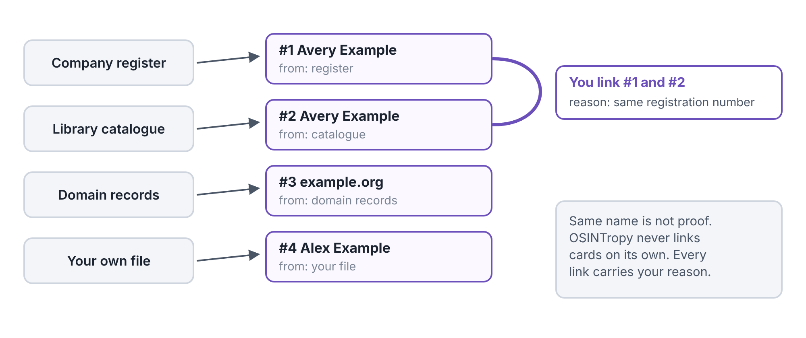
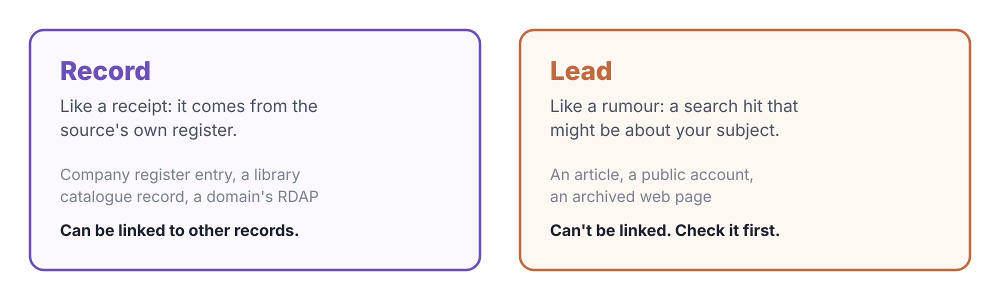
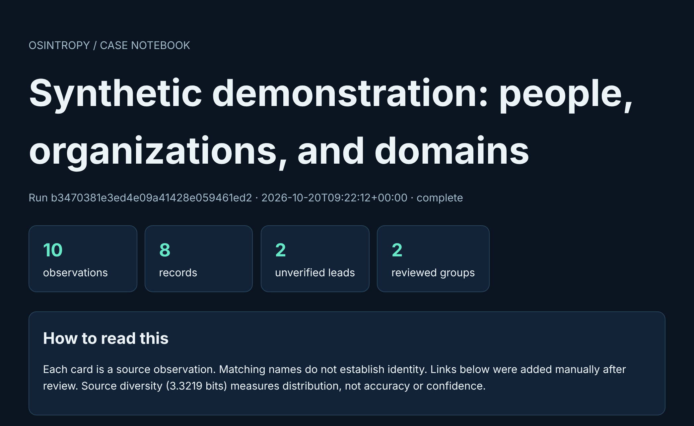
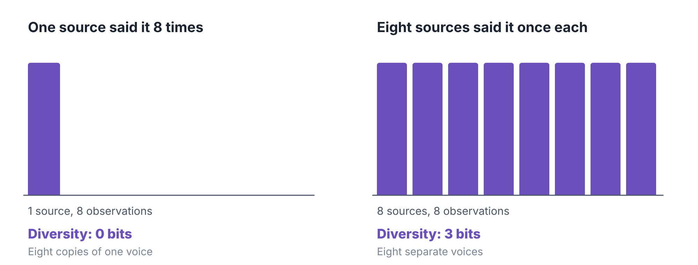
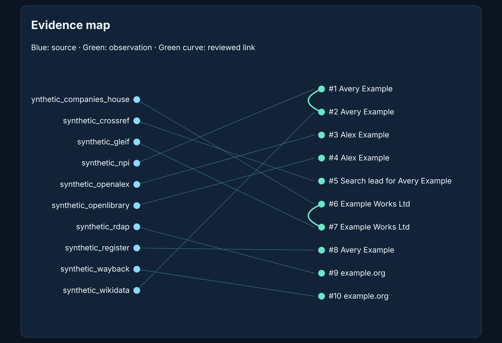
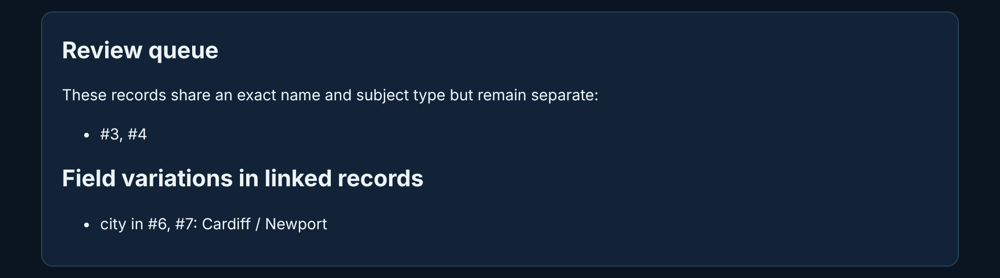
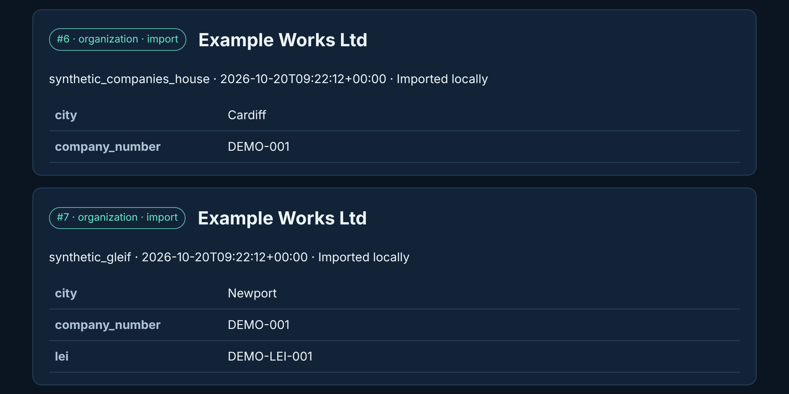

# OSINTropy

*A case notebook for public records, where every scrap of evidence keeps a label saying exactly where it came from.*

OSINTropy 5.0.0 · a quickstart guide from whispr.dev

Picture a good detective’s evidence locker. Every item is bagged, and every bag has a tag: where it was found, when, and by whom. Nothing is thrown in loose, and two items are only filed together once someone has checked, and written down why. OSINTropy is that locker for public information. It searches open directories for a person, a company or a website, keeps each result as its own labelled card, and never decides on its own that two matching names are the same person.

## What it does, in one minute

“OSINT” means **open-source intelligence**: information anyone can look up, such as company registers, library catalogues and website records. The trouble with public information isn’t finding it. It’s keeping track of where each bit came from, and not fooling yourself. Search for “Avery Example” and you may get five results. Are they one person, or five people who share a name?

OSINTropy’s answer is simple: **every result stays separate until you say otherwise.**

<figure>

<figcaption aria-hidden="true">Each source gives you observation cards. OSINTropy never joins cards by itself. You link two cards, and the link carries your reason.</figcaption>
</figure>

Everything lives in a **case file** on your own computer. OSINTropy only goes on the internet when you ask it to search. The demo, imports, reports and exports all work offline.

> **Words you'll meet**
>
> **Observation:** one result from one source, kept exactly as found. Shown as a numbered card, such as `#3`.
>
> **Source:** where an observation came from, such as a company register or a library catalogue.
>
> **Record:** an observation from a source’s own official list. A receipt.
>
> **Lead:** a search hit that *might* be about your subject. A rumour, until you check it.
>
> **Link:** your decision that two records are about the same subject, with the reason you give.
>
> **Run:** one search or import, with everything it found. Each run has an ID.
>
> **Case file:** the file on your computer that holds all your runs, cards and links.

<figure>

<figcaption aria-hidden="true">Records and leads are kept apart. You can link records to each other; leads must be checked first.</figcaption>
</figure>

## Get it on your computer

OSINTropy is free. Download it from the **Releases** page of github.com/whisprer-specops/osintropy-community, or from skeletrace.com/works-with.

| Your computer             | Download                             | Then                                                                                                                                               |
|---------------------------|--------------------------------------|----------------------------------------------------------------------------------------------------------------------------------------------------|
| Windows 10 or 11          | `osintropy-windows-x86_64-setup.exe` | Double-click it. Windows may say “Windows protected your PC”, because the program isn’t code-signed yet. Click **More info**, then **Run anyway**. |
| Mac (Apple chip or Intel) | `osintropy-macos-universal.run`      | Open Terminal and type `sh ~/Downloads/osintropy-macos-universal.run`                                                                              |
| Linux (most PCs)          | `osintropy-linux-x86_64.run`         | Open a terminal and type `sh ~/Downloads/osintropy-linux-x86_64.run`                                                                               |
| Linux on ARM              | `osintropy-linux-aarch64.run`        | As above, with that file name                                                                                                                      |

The installer shows the licence and asks you to accept it (on a Mac or Linux, press Space to page through, then type `y`). It then suggests a folder: on Windows `%LOCALAPPDATA%\Programs\OSINTropy`, on a Mac `~/Applications/OSINTropy`, and on Linux `~/OSINTropy`. Press Enter to accept. Nothing else changes; to remove OSINTropy, delete the folder.

## Your first five minutes: the demo case

The demo builds a small, invented case offline and turns it into a report you open in your browser. It keeps the demo in its own case file, so it never mixes with your real work.

1.  Open a terminal and go to the program’s folder. On Windows:

    ``` powershell
    cd "$env:LOCALAPPDATA\Programs\OSINTropy"
    ```

    On a Mac, type `cd ~/Applications/OSINTropy`; on Linux, `cd ~/OSINTropy`. Then use `./osintropy` wherever this guide says `.\osintropy.exe`.

2.  Make the demo case and its report:

    ``` powershell
    .\osintropy.exe --db demo-case.db demo --out demo.html
    ```

    It prints a line like `Run: b3470381… | 10 observations | complete`.

3.  Open the report:

    ``` powershell
    Invoke-Item demo.html
    ```

    On a Mac, type `open demo.html`; on Linux, `xdg-open demo.html`.

Every name in the demo is made up, and every source name starts with `synthetic_`, so nobody real is described.

## Reading the report

The report is a single web page that works offline. It opens with the numbers that matter, and a reminder of how to read them.

<figure>

<figcaption aria-hidden="true">The top of the demo report. Ten observations: eight records and two unverified leads, with two groups you’ve reviewed and linked.</figcaption>
</figure>

**Source diversity** in that box needs a word of explanation. It measures how *spread out* your sources are, in a unit called **bits**. If all your observations come from one source, it’s 0. Each time you double the number of sources, contributing equally, it goes up by 1. The demo has ten observations from ten different sources, so it scores about 3.3.

<figure>

<figcaption aria-hidden="true">Source diversity measures how mixed the sources are. Eight separate sources score 3 bits; one source repeating itself scores 0.</figcaption>
</figure>

> **Heads-up**
>
> High diversity doesn’t mean a claim is true. Ten sources can all copy the same mistake. Diversity tells you how many different places you’ve looked, nothing more.

### The evidence map

Next comes a picture of the whole case. Sources sit on the left, cards on the right, and a line shows which source gave which card. A green curve joins two cards you have linked.

<figure>

<figcaption aria-hidden="true">The evidence map. Cards #1 and #2 have been linked (the green curve on the right), and so have #6 and #7.</figcaption>
</figure>

### The review queue

OSINTropy spots cards that share an exact name and type, and lists them for you to check. It **doesn’t** link them. In the demo, cards \#3 and \#4 are both called “Alex Example”, but one is a researcher and one is an author. They might be the same person, or two different people.

<figure>

<figcaption aria-hidden="true">The review queue, and a warning about linked records that disagree. Two linked company records give different cities: Cardiff and Newport.</figcaption>
</figure>

The second part, **field variations**, matters just as much. It shows where cards you *have* linked disagree. The demo’s two company records share a company number, but one says Cardiff and the other Newport. That’s worth a second look: maybe the company moved, or maybe one record is wrong.

### The cards

Below the overview, every observation has its own card: its number, type, source, the time it was collected, and every field the source gave.

<figure>

<figcaption aria-hidden="true">Cards #6 and #7: the same invented company from two sources, with the city that differs.</figcaption>
</figure>

## Search for real

These are the only commands that go on the internet. Each search becomes a new run in your case file.

``` powershell
# A person
.\osintropy.exe search Ada Lovelace
# A company
.\osintropy.exe search-org "Example Holdings Ltd"
# A website
.\osintropy.exe domain example.org
# Every source, and what each needs
.\osintropy.exe sources
```

Without extra options, each search uses the sources that need no account or key:

| Search                   | Default sources   | What they hold                                          |
|--------------------------|-------------------|---------------------------------------------------------|
| `search` (a person)      | `npi`, `wikidata` | US healthcare providers; notable people on Wikidata     |
| `search-org` (a company) | `gleif`           | The worldwide register of company identity codes (LEIs) |
| `domain` (a website)     | `rdap`            | The official registration record for the domain         |

Add `--source NAME` to choose others, once for each source you want. Some are free with no key, such as `openlibrary` (library catalogues) and `crossref` (published papers). Others need a free account or key, such as `companies_house_officers` for UK company directors. `.\osintropy.exe sources` lists every one, and says what it needs.

``` powershell
.\osintropy.exe search Ada Lovelace --source openlibrary --source crossref
```

> **Tip**
>
> Keys go in your terminal, never in a command or a file, so they don’t end up in your history or a report. For example, for Companies House:
>
> ``` powershell
> $env:COMPANIES_HOUSE_API_KEY = Read-Host 'Companies House key'
> .\osintropy.exe search Avery Example --source companies_house_officers
> ```
>
> On a Mac or Linux, type `read -rs COMPANIES_HOUSE_API_KEY` and paste the key (it stays hidden), then `export COMPANIES_HOUSE_API_KEY`. Either way, the key lasts until you close that terminal window.

> **Heads-up**
>
> OSINTropy is careful by design. It asks each source for at most the first 10 to 20 results, waits a second between requests to the same site, and never pages through a whole database. If a source fails, the run is still saved, with a note of the error.

## Review and link

Your case grows run by run. These commands let you look through it and record your decisions.

1.  List your runs, newest first, with their IDs:

    ``` powershell
    .\osintropy.exe list
    ```

2.  Show everything in one run (copy its ID from the list):

    ``` powershell
    .\osintropy.exe show RUN_ID
    ```

3.  Look closely at one card by its number:

    ``` powershell
    .\osintropy.exe inspect 3
    ```

4.  When you’re sure two records are the same subject, link them, and say why:

    ``` powershell
    .\osintropy.exe link 3 4 --reason "Same ORCID iD on both records"
    ```

A link needs a reason, two records (not leads) and the same type of subject on both sides. Changed your mind? `.\osintropy.exe unlink 3 4` takes it back.

## Export and share

``` powershell
# The report you saw in the demo
.\osintropy.exe export RUN_ID --out case.html
# For graph tools and the SkeleTrace viewer
.\osintropy.exe export RUN_ID --format graphml --out case.graphml
# For spreadsheets
.\osintropy.exe export RUN_ID --format csv --out case.csv
# Everything, complete
.\osintropy.exe export RUN_ID --format json --out case.json
```

A GraphML export opens in the SkeleTrace viewer at **skeletrace.com/viewer**. There, the case becomes a graph you can explore, with sources, records and leads told apart, and the viewer marks the weak points: for example, the one link a whole identity rests on.

<figure>

<figcaption aria-hidden="true">The demo case, exported as GraphML and opened in the SkeleTrace viewer.</figcaption>
</figure>

## Bring your own observations

Got notes from somewhere OSINTropy doesn’t search? Put them in a spreadsheet and save it as CSV. It needs two columns, `source` and `name`; any other columns become fields on the card.

``` text
source,name,city,occupation
local_register,Avery Example,Sampleton,Engineer
```

``` powershell
.\osintropy.exe import-file .\my-notes.csv
```

The full guide also covers JSON imports, and how to bring in cases from the old Python version.

## Keep your cases safe

Your case file holds information about real people, so treat it with care.

- **Where it lives.** On Windows, `%LOCALAPPDATA%\osintropy\cases.db`; on a Mac or Linux, `~/.local/share/osintropy/cases.db`.
- **Keep a case somewhere else**, such as an encrypted drive, by putting `--db` and a file name before the command: `.\osintropy.exe --db E:\cases\client-a.db search Avery Example`.
- **Back it up** with `.\osintropy.exe backup --out cases-backup.db`.
- **Tidy up** with `delete RUN_ID` for one run, or `prune --days 30` for every run older than 30 days.
- **Don’t** keep case files in a shared, synced or public folder.

## What it can and can’t tell you

> **What it can't tell you**
>
> **A card is a source hit, not a person.** OSINTropy shows you what each source said. It never decides who is who. Only your links do that.
>
> **Public directories can be wrong or out of date.** A register is only as good as the last time someone updated it.
>
> **Diversity measures the mix, not the truth.** See the heads-up above.
>
> **It isn’t a background-check service.** Use it for a purpose you’re entitled to, keep only what you need, and follow each source’s terms and the data protection law where you are.

## Cheat sheet

| To do this                       | Type this (Windows; use `./osintropy` on Mac and Linux)             |
|----------------------------------|---------------------------------------------------------------------|
| Try the demo                     | `.\osintropy.exe --db demo-case.db demo --out demo.html`            |
| Search for a person              | `.\osintropy.exe search FIRST LAST`                                 |
| Search for a company             | `.\osintropy.exe search-org "COMPANY NAME"`                         |
| Look up a website                | `.\osintropy.exe domain example.org`                                |
| See every source                 | `.\osintropy.exe sources`                                           |
| List your runs                   | `.\osintropy.exe list`                                              |
| Link two records                 | `.\osintropy.exe link 3 4 --reason "what you checked"`              |
| Make a report                    | `.\osintropy.exe export RUN_ID --out case.html`                     |
| Export for the SkeleTrace viewer | `.\osintropy.exe export RUN_ID --format graphml --out case.graphml` |
| Back up                          | `.\osintropy.exe backup --out cases-backup.db`                      |
| Help on any command              | `.\osintropy.exe help export`                                       |


## Where to go next

The full guide, with every source’s details, is on GitHub at github.com/whisprer-specops/osintropy-community, along with the downloads under Releases. skeletrace.com/works-with shows how OSINTropy fits with the other tools.

The whole set, each one free software under GPL-3.0-only:

- **SkeleTrace**: A detective’s pinboard that does the maths
- **Maxwell’s Demon Detector**: Network traffic as a river of racing lanes
- **OSINTropy**: An evidence locker for public records
- **CrowdWatch**: What normal looks like, and when today isn’t

All four quickstart guides are at skeletrace.com/guides.

*OSINTropy 5.0.0. © 2026 whispr.dev. Screenshots are from the program itself; every example in them is invented.*
